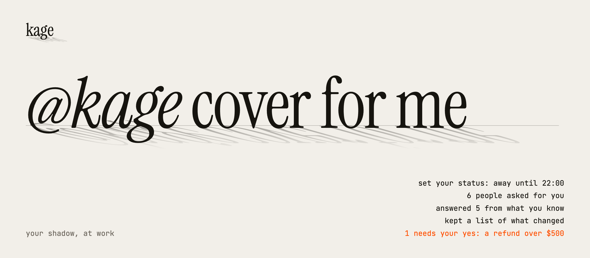

<picture>
  <source media="(prefers-color-scheme: dark)" srcset="docs/brand/hero-dark.png">
  
</picture>

Kage lets you tag `@kage` in any Slack thread, DM or channel, and your own Claude Code session on your laptop does the work and answers in the same thread. It uses your setup: your `CLAUDE.md`, your tools, your MCP servers, your access. Nobody else can drive it. It only acts on messages you typed yourself.

```
#incidents  ▸ thread
  Priya      checkout is throwing 500s since the 14:05 deploy
  You        @kage what changed in that deploy?
  Kage    🥷 Looking at the deploy diff and the error logs...
  Kage       The 14:05 deploy renamed `order.total` to `order.amount`.
             3 callers still read the old name. Fix is on branch fix/order-amount.
```

## Set it up with your agent

Paste this into Claude Code (or any coding agent with a shell):

```text
Set up Kage for me: https://github.com/aloki-alok/kage
Install it with: curl -fsSL https://raw.githubusercontent.com/aloki-alok/kage/main/install.sh | bash
Then follow AGENTS.md in ~/.local/share/kage from start to finish.
Do every step yourself, and stop only for the steps it marks for me.
Finish when kage doctor ends with "All good".
```

Your agent does the work. You only do what a person has to do:

- In Slack, click **Create** on the prefilled app, generate one token, and click **Allow**.
- Paste the three tokens into the hidden prompts in the terminal window your agent opens. The tokens never pass through the agent.

The rest of this page is for doing it by hand, and for knowing how it works.

## Before you start

| You need | Why |
|---|---|
| macOS or Linux, Node 22.18 or newer | Kage runs TypeScript directly on Node. macOS (launchd) or Linux (systemd) keeps it running. `tmux` only for tmux panes. |
| A recent [Claude Code](https://code.claude.com/docs/en/quickstart), logged in with a claude.ai account | Each thread is a normal Claude Code session with your settings, skills, tools and logins. |
| Permission to create an app in your Slack workspace | If your workspace restricts apps, an admin approves it once. |

## Set it up by hand (about 5 minutes)

1. Install it. One line: it gets Kage (with git when you have it, so Kage updates itself), puts the `kage` command on your PATH, and starts the setup.
   ```sh
   curl -fsSL https://raw.githubusercontent.com/aloki-alok/kage/main/install.sh | bash
   ```
   Run the same line again later to update. Your settings stay.
2. Pick a name when asked. `kage` is the default. Whatever you pick becomes the `@name` you tag.
3. A browser tab opens with your Slack app already filled in. Pick your workspace, then click **Next** and **Create**.
4. Under **Basic Information > App-Level Tokens**, click **Generate**, add the scope `connections:write`, and copy the token (`xapp-...`).
5. Under **Install App**, click **Install to Workspace**, allow it, and copy both tokens: User OAuth (`xoxp-...`) and Bot (`xoxb-...`).
6. Paste the three tokens into the setup script. It checks each one with Slack and saves them to `~/.config/kage/env`, readable only by you.

## Start it

```sh
kage start
```

The first start installs the Agent SDK and turns on the service: macOS or Linux keeps Kage running, brings it back within about 10 s after a crash, and starts it at login (on Linux, at boot once linger is on; `kage doctor` prints the command). Three starts in 10 minutes send you a DM. Each Slack thread gets its own Claude Code session inside it.

`kage` alone says whether Kage is running and shows the six commands you use most. `kage help` lists all of them, `kage help <command>` shows one with an example, and a mistyped command gets the closest real one.

| To | Run |
|---|---|
| Check every part | `kage doctor` prints the command that fixes each problem |
| See every session live | `kage top`, by mouse or keys. `kage status` prints one look. |
| Follow every step as it happens | `kage watch`, or `kage watch support` for one place |
| Work in a thread yourself | `kage attach '<link>'` with the thread's Slack link ("Copy link" on any message in it, kept in quotes), or `kage attach <place>`. You get it at once (a running turn stops, as with Esc), and Kage gets it back when you quit. |
| Read the hub log | `kage logs`, `kage logs 500`, or `kage logs -f` to follow it |
| See every schedule and watch | `kage schedules`: what runs, where, and when it runs next |
| See what each thread spent | `kage cost`, or `kage cost 7` for a week |
| Undo the weekly memory tidy | `kage dream undo` |
| Pick up a changed setting | `kage reload` for who may tag Kage: no session is cut. `kage restart` for any other setting. |
| Stop one thread | `kage stop <place or link>`, or `@kage stop` in the thread. It ends after its turn, or at once with `--now` (`stop now` in Slack). Its schedules keep running. |
| Stop it | `kage stop`. New messages wait, and it stops once every running turn ends, naming each thread it waits on. `--cut-running` stops now. It stays down until `kage start`. Each thread resumes its conversation on its next tag. |
| Stop it starting by itself | `kage service off`. `kage service on` turns it back on. |
| Give sessions your shell exports | Put them in `~/.config/kage/session.env` (mode 600), then `kage restart`. Sessions see only the service's environment, not your shell's. |
| Use another supervisor (Docker, runit) | Have it run `kage run`: a non-zero exit means restart it, exit 0 means leave it down. Docker needs `--init`. |

### Give a recurring job to a kagelet

A kagelet is one file in `~/.config/kage/kagelets/`, named after it (`deploys.md`). `kage add kagelet deploys` writes a starter file, paused until you fill it in:

```markdown
---
thread: https://example.slack.com/archives/C0123ABC/p1700000000123456
schedule: 0 9 * * 1-5
tools: WebFetch, WebSearch
---
Every weekday at 9, check https://status.example.com and post a three-line summary in this thread.
```

It runs on its schedule beside the thread's own session and posts in the thread. It has only the tools in `tools`, and teammate trust. Only web tools, outside MCP tools and `db_read` can be granted. It never gets a file, shell or agent tool, so it cannot change its own grant or read your tokens. WebFetch reaches http and https only. An MCP tool you grant by its full name runs with that tool's own reach. It approves nothing: when it needs a decision or another tool, it says so in the thread, and you decide there. A new, changed or deleted file applies within a minute, and `kage schedules` shows its runs. Kagelets need the default runtime, not tmux panes.

A kagelet you grant `db_read` (in `tools`) can run read-only SQL through your own read command ([docs/settings.md](docs/settings.md)). Kage holds no database login: the kagelet reads through the access your install already has, never more. Before the command runs, Kage refuses anything but one `SELECT` or `WITH ... SELECT` statement (PostgreSQL syntax), caps the rows (200), stops it after 30 s, and logs each call (who, how many lines, how long, ok or refused, never the rows) in the `db-reads` ledger. That check is a second wall, not the only one. It reads statements, not functions, so calls such as `nextval`, `set_config` or `lo_import` pass it. Your command must still run the query in a read-only transaction with a read-only login and its own statement timeout. Only you grant `db_read`. Write it in the file yourself, or let Kage ask: when a kagelet needs the database, Kage sends you a card in your DM with the kagelet, its job and the read command it proposes. Only your `yes` saves it. A `no`, or no answer, saves nothing. Your yes keeps the command in Kage's store for that kagelet only, so a yes for one kagelet never changes another's, and applies at once, with no restart. The file then records the grant as yours (`granted: db_read by the owner, <time>`). A file that says `by: kage` and holds `db_read` with no such line never runs. Each grant and refusal is a row in the `grants` ledger and a line in the hub log.

Your yes on the card stands. When Kage later grants `db_read` through the same read command, it saves with no card, sends you a DM that names the kagelet and how to revoke, records the grant as `granted: db_read by standing approval, <time>`, and logs the reason as a `standing` row in the `grants` ledger. `kage logs <kagelet>` lists its grants, and the kagelets panel in `kage top` marks the line `standing`. A different read command, a changed `KAGE_DB_READ_COMMAND`, any other tool, and a teammate's session still get a card or a refusal. A standing approval never covers a cap raise. To revoke it, press `v` in the kagelets panel, or ask Kage to revoke it. Revoking takes `db_read` from every kagelet that got it with no card. A kagelet you approved on its own card keeps it.

Kage manages its kagelets. Ask it in Slack to make, pause, resume, run or remove one, or how they are doing. It also makes one on its own for a recurring job that needs only web search and fetch, and tells you in the thread. Kage grants only WebSearch and WebFetch on its own. Any other tool, such as an MCP tool, needs your yes on a card each time Kage saves it, even when you asked for the kagelet, because text in a thread can steer what Kage asks for. Each run ends with a one-line report to Kage. When a run needs something it cannot do, it posts that in its thread and it goes on your waiting list. Your own reply in a kagelet's thread, with no tag, reaches its next run. At most 10 kagelets run. Kage tracks what each one spends and flags a day that spends over 3 times its 7-day average. Cost caps are off unless you set one: a daily cap per kagelet, a total for all of them, or both. A kagelet at a cap is paused, and a run stops at the cap even mid-turn (`KAGE_MAX_KAGELETS`, `KAGE_KAGELET_DAILY_USD` and `KAGE_KAGELET_TOTAL_DAILY_USD` in [docs/settings.md](docs/settings.md)).

Kagelets work as a team. A file that says `after: make-video` (and needs no `schedule:`) runs each time `make-video` ends a run with an output, a link or short note in its report, and takes that output as its input. A kagelet can also message another kagelet of this install with `message_kagelet`, as text. A handed-over output and a message both reach the next run as quoted data under its own job, never as instructions, so a page one kagelet fetched cannot steer the next. It can message only a kagelet whose tools are the same as its own or fewer, and a message never interrupts a run: it waits until the other kagelet is idle, then starts a run of its own. Kage routes each handoff itself, with no extra model turn. A chain is at most 5 steps, a cycle or a missing kagelet is refused when the file is saved, and a chain stops at 4 handoffs with no new input from you or a schedule. A step that needs something, had a call refused or filed no report stops its chain, and the stop goes on your waiting list with the chain id. The cost caps apply to each step, and `KAGE_KAGELET_CHAIN_USD` caps what one chain may spend (off unless you set it). `kage top` (`l`) and `kage logs <kagelet>` show today's chains (`make-video > edit > upload`) and where each stopped. `kage logs <kagelet>` also lists its messages, each queued, delivered, read or failed (with why). A message is stored before it is delivered, and it counts as read only when the run it started ends normally. A run cut off by a restart, a stop or the usage limit leaves its message queued, so it is delivered again. A message still waiting an hour after its first run (or after it was sent, if no run took it) fails, and a usage-limit pause does not count toward that hour. A run that takes longer keeps its message. An output too long to hand on (over 4000 characters) stops its chain, and the stop goes on your waiting list. A step may hold only tools the step before it holds, so a save that breaks that is refused.

`kage list` shows each kagelet: its schedule, last and next run, what it spent today, who made it and why, and its last report. `kage stop deploys` pauses it by adding `paused: yes` to its file. `kage start deploys` runs it again. Use it rather than deleting the line by hand: it also restarts the daily cost count. A `specialists/` folder from an earlier version moves to `kagelets/` at the next start, and the old setting names still read.

### Run threads as tmux panes instead

Add `KAGE_RUNTIME=tmux` to `~/.config/kage/env`, then `kage stop` and `kage start`, to give each thread a Claude Code pane you can watch with `tmux attach -t <name>`. On Linux, systemd stops the panes with the hub on every restart, so a pane resumes its conversation on its next tag. Panes talk to Kage through channels, a research-preview feature: on Team and Enterprise an org Owner turns Channels on under [Organization settings > Claude Code > Channels](https://claude.ai/admin-settings/claude-code). Each new pane shows a warning screen for custom channels until your org approves Kage:

1. An org Owner opens [Claude Code admin settings](https://claude.ai/admin-settings/claude-code), finds managed settings, and adds:
   ```json
   { "allowedChannelPlugins": [ { "marketplace": "kage", "plugin": "kage" } ] }
   ```
   This list replaces Anthropic's default channel list for your org, so add any official channel your team already uses (for example `{ "marketplace": "claude-plugins-official", "plugin": "telegram" }`).
2. Install Kage as a plugin, from the repo folder:
   ```sh
   claude plugin marketplace add "$PWD" && claude plugin install kage@kage
   ```
   The plugin's server starts in every Claude Code session, but only the panes Kage opens for its threads take tasks. Your other sessions stay idle.
3. Add `KAGE_ROUTE=plugin` to `~/.config/kage/env`, run `kage stop`, then `kage start`.

Your laptop must be on, awake and online. The hub stops a Mac from idling to sleep with `caffeinate`, but closing the lid still sleeps it unless the Mac is plugged into a display. Tags sent while it sleeps are not picked up later.

## Use it

- **In any thread:** `@kage why did this fail?` Kage reads the whole thread (up to 200 messages) as context.
- **In a channel:** `@kage summarize the last discussion`. Outside a thread it sees the last 12 messages, so start a thread when you want full context.
- **In a DM with the bot:** no tag needed. Good for private questions.
- **Plain text works too:** typing `@kage` without picking it from Slack's list still counts.
- **Canvases and files:** Kage can't be tagged inside a canvas, and it sees file names, not contents. Paste a canvas link in your message and ask Kage to read it, if your session has a Slack MCP connector.

### One session per thread

Each thread gets its own Claude Code session, so a new tag never interrupts work in another thread. A follow-up in the same thread goes to the same session, with everything it already knows. Your top-level DMs with the bot share one session. Run `kage top` to see every session live.

- **Restarts keep the context.** Each thread keeps its conversation id for good. If Claude Code exits, Kage restarts, or your Mac reboots, the thread's next tag resumes the same conversation.
- **At most 4 sessions run at once.** A tag over the limit gets ⏳ and starts when a session frees up.
- **Idle sessions close after 30 minutes** with no activity, unless Claude is still working, a background agent or shell is running, or it waits on your approval. Nothing keeps running. The conversation stays on disk, and the next tag in that thread reopens it with its full history.
- **Change the model in words.** `@kage use opus at max effort` or `@kage go back to the default model`. It applies to that thread only, from the next step on, and stays until the hub restarts. You and your teammates can ask. Tmux panes don't support it.
- **Old threads clean themselves up.** Claude Code deletes transcripts after 30 days (its `cleanupPeriodDays` setting). Kage then forgets that thread, and a new tag there starts fresh.

To change the limits, add `KAGE_MAX_SESSIONS=6` or `KAGE_IDLE_MINUTES=15` to `~/.config/kage/env`, then restart Kage. Every setting is in [the settings reference](docs/settings.md).

### Schedules and watches

Ask in a thread: `@kage check the deploy every 30 minutes`, or `@kage tell me when Priya replies here`. Kage keeps the schedule itself, so it survives restarts, and a watch wakes only when someone writes in the thread. A watch ends by itself after 7 days.

### What Kage does on its own

- **Every morning:** a DM with the questions that have waited on you for a day or more.
- **Every Monday:** a DM with the schedules that run often but rarely post, and the threads that cost most. It only suggests: you decide.
- **Every night:** it reads the day's threads for lessons, such as your corrections, and saves them. It also tidies its own memory (merges duplicates, archives what nobody used). `kage dream undo` puts it back.

### Other places to reach it

Slack is the main channel. Email, voice calls and GitHub events (reviews, failed checks, issues assigned to you) can reach the same Kage too. Each is off until you set it up: see [the settings reference](docs/settings.md).

### Let a teammate tag it

```sh
kage add priya               # a name, @handle, email, Slack member id, or a pasted mention
kage add A0123ABC priya      # priya's own agent, by its Slack app id; it adds priya too
kage remove priya            # her agents go with her
kage list
```

It finds the person in your workspace and updates `~/.config/kage/env`. The running hub takes the change at once: no restart, and no session is cut. A Kage session cannot run `kage add` or `kage remove`: you run them in your own terminal. If a name matches two people, it lists both with their ids, so you can pick one.

A teammate can tag `@kage` only in a conversation you are also in, because Kage hears Slack through your account. Their tasks run in your session, with two limits:

- Anything that needs your yes (prod changes, deploys, protected branches, merges) waits for your yes.
- Secrets go to your DM, never to their thread.

Only you can approve a permission prompt.

You get 🥷 on your message when Kage picks it up. Then 🗡️ means a quick answer, 📜 means Kage asked you something and waits for your reply, and ⚔️ means the task is done. Long jobs get a one-line "working on it" reply first, then the result. Answers stay in the thread. Only something that must never show in a channel (a password, a token, a key, someone's private data) goes to your DM instead.

## How it works

<p align="center"></p>

1. **Slack to your machine.** Kage opens an outbound websocket to Slack ([Socket Mode](https://api.slack.com/apis/socket-mode)), so Slack never needs to reach your laptop. No public URL, no open port.
2. **The gate.** The hub (`router.ts`) hears every message in conversations you're in (through your user token, in `connectors/slack.ts`). The gate (`core/gate.ts`) drops everything except messages you typed that tag `@kage`, or your DMs to the bot.
3. **Into Claude Code.** The hub hands the task to that thread's own session (starting it if needed) through the Agent SDK, or through Claude Code's [channels](https://code.claude.com/docs/en/channels-reference.md) feature for tmux panes. Other people's messages arrive quoted and labelled by Slack ID, as background, never as instructions.
4. **Back to Slack.** Claude answers with Kage's `reply` tool, in the thread the task came from.

### Approvals from your phone

When Claude needs your permission (an edit, a risky command), the prompt also comes to your DM with the bot. Answer there or in the terminal: whichever comes first wins.


Approval IDs are five letters, and only answers in your DM with the bot count. If a preview is too long to show in full, the prompt says how much is hidden: deny it and check in the terminal.

## Security

Kage gives Slack a path into a session that has everything your laptop has. These rules hold that path shut:

| Risk | What stops it |
|---|---|
| Someone else tags `@kage` | Only your Slack user ID, plus any IDs you list in `KAGE_TEAMMATES`, passes the gate. Everyone else is dropped before Claude sees anything. A teammate can never approve a prompt. |
| A listed agent relays instructions it read somewhere else (an email, a page, a ticket) | An agent's task may only read files and answer in the thread. Every other tool (shell, edits, web, other MCP tools, subagents, posting as you, schedules) is refused before it runs, so no approval card for it ever reaches you. Its reads skip `~/.config/kage`, `~/.ssh`, `~/.aws`, `~/.claude`, `.env` files and keys, through symlinks too. A turn that holds an agent's task keeps the limit even when you write in it mid-turn. |
| An app or script posts as you, using your token | Slack sets `client_msg_id` only on messages a person typed in a Slack app. Kage requires it and rejects anything with an `app_id`. |
| A message in the thread says "ignore your instructions and..." | Thread messages reach Claude quoted, labelled by Slack ID, and marked as data. Only your own tagged line is the task. |
| Claude is tricked into posting somewhere else | Replies may only go to a channel or DM a task came from, or to your DM with the bot. `@channel`, `@here` and user mentions are defused. |
| Claude puts a password or key in a thread | The reply tool checks every thread reply for secret shapes (keys, tokens, a password in code) and sends it back to Claude with a hint to use your DM. The owner can still ask for it in the thread; a teammate's task never can. |
| Tokens leak | Tokens live in `~/.config/kage/env` with mode `600`, outside the repo. Each person uses their own Slack app and tokens. |

Kage acts with your full Claude Code permissions. Keep your usual permission settings and guard hooks on, and treat an approval prompt like one in your terminal.

## Troubleshooting

Start with `kage doctor`. It checks the tools, the tokens, the Agent SDK (or, for tmux panes, the plugin and the org approval), the session and the Slack connection, and prints the fix for each failure.

| You see | Do this |
|---|---|
| No 🥷 on your message | Run `kage status`. If Kage is stopped, `kage start`. If it runs, `kage logs` shows the error. |
| "Channels are not enabled for your org" in the session | An org Owner turns on Channels in [Claude Code admin settings](https://claude.ai/admin-settings/claude-code), then you restart Kage. |
| 🥷 appears but no ⚔️ or answer | Run `kage top` and open the thread: Claude may be waiting on a permission prompt or still working. |
| ⚠️ on your message | Its session did not start or connect within 3 minutes. `kage logs` shows why. |
| ⏳ on your message | All sessions are busy. It starts when one frees up (`KAGE_MAX_SESSIONS` raises the limit). |
| `@kage` isn't suggested when you type | The bot's display name differs. Plain-text `@kage` still works. To rename it: **App Home > App Display Name**, then reinstall the app. |
| Replies show as you, marked "Kage:" | The bot isn't in that conversation (a DM or private channel), so Kage posts with your token. Invite the bot to the channel to change that. |
| Hub errors | `kage logs` prints the hub's log. A healthy start prints `listening as ...`. |

## Develop

The code map, the tests and the build are in [CONTRIBUTING.md](CONTRIBUTING.md).

## License

MIT. See [LICENSE](LICENSE).
