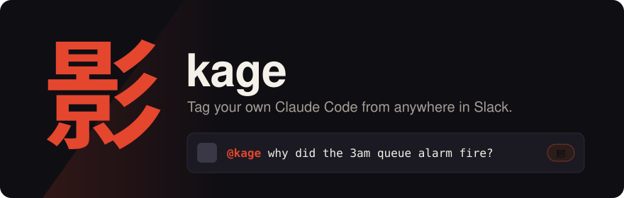
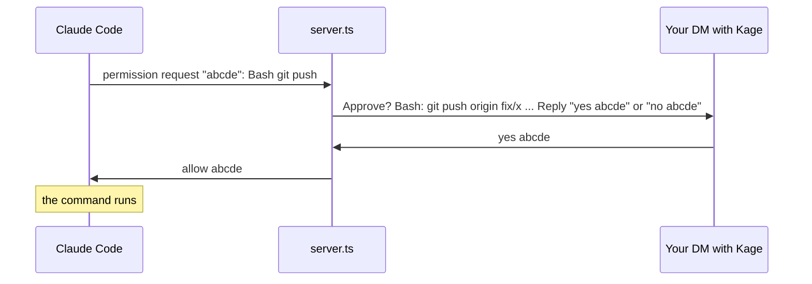

<p align="center"></p>

Kage lets you tag `@kage` in any Slack thread, DM or channel, and your own Claude Code session on your laptop does the work and answers in the same thread. It uses your setup: your `CLAUDE.md`, your tools, your MCP servers, your access. Nobody else can drive it. It only acts on messages you typed yourself.

```
#incidents  ▸ thread
  Priya      checkout is throwing 500s since the 14:05 deploy
  You        @kage what changed in that deploy?
  Kage    🥷 Looking at the deploy diff and the error logs...
  Kage       The 14:05 deploy renamed `order.total` to `order.amount`.
             3 callers still read the old name. Fix is on branch fix/order-amount.
```

## Before you start

| You need | Why |
|---|---|
| macOS or Linux, Node 22.18 or newer, `tmux` | Kage runs TypeScript directly on Node and lives in a background terminal. |
| A recent [Claude Code](https://code.claude.com/docs/en/quickstart), logged in with a claude.ai account | Kage feeds messages into a normal Claude Code session through channels, a research-preview feature. Update with `claude update` if the channel never registers. |
| Channels turned on for your Claude org | Team and Enterprise only: an org Owner turns it on once under [Organization settings > Claude Code > Channels](https://claude.ai/admin-settings/claude-code). Personal Pro and Max accounts skip this. |
| Permission to create an app in your Slack workspace | If your workspace restricts apps, an admin approves it once. |

## Set it up (about 5 minutes)

1. Clone and run the setup script:
   ```sh
   git clone https://github.com/aloki-alok/kage && cd kage && ./setup.sh
   ```
2. Pick a name when asked. `kage` is the default. Whatever you pick becomes the `@name` you tag.
3. A browser tab opens with your Slack app already filled in. Pick your workspace, then click **Next** and **Create**.
4. Under **Basic Information > App-Level Tokens**, click **Generate**, add the scope `connections:write`, and copy the token (`xapp-...`).
5. Under **Install App**, click **Install to Workspace**, allow it, and copy both tokens: User OAuth (`xoxp-...`) and Bot (`xoxb-...`).
6. Paste the three tokens into the setup script. It checks each one with Slack and saves them to `~/.config/kage/env`, readable only by you.

## Start it

```sh
./start.sh
```

On the first start, Claude Code may ask whether you trust your home folder: choose **Yes**. Then it shows a warning screen for custom channels, on every start (Kage is not on Anthropic's built-in channel list). Press Enter on **"I am using this for local development"**, then press `Ctrl-b` and then `d` to leave it running in the background.

| To | Run |
|---|---|
| See what it's doing | `tmux attach -t <name>` (your name, `kage` by default) (leave with `Ctrl-b` then `d`) |
| Stop it | `tmux kill-session -t <name>` |
| Restart after changing code or settings | stop it, then `./start.sh` |

Your laptop must be on, awake and online. `start.sh` stops a Mac from idling to sleep with `caffeinate`, but closing the lid still sleeps it unless the Mac is plugged into a display.

## Use it

- **In any thread:** `@kage why did this fail?` Kage reads the whole thread (up to 200 messages) as context.
- **In a channel:** `@kage summarize the last discussion`. Outside a thread it sees the last 12 messages, so start a thread when you want full context.
- **In a DM with the bot:** no tag needed. Good for private questions.
- **Plain text works too:** typing `@kage` without picking it from Slack's list still counts.
- **Canvases and files:** Kage can't be tagged inside a canvas, and it sees file names, not contents. Paste a canvas link in your message and ask Kage to read it, if your session has a Slack MCP connector.

You get 🥷 on your message when Kage picks it up, and ⚔️ when it has answered. Long jobs get a one-line "working on it" reply first, then the result. Answers stay in the thread. Only something that must never show in a channel (a password, a token, a key, someone's private data) goes to your DM instead.

## How it works

<p align="center"></p>

1. **Slack to your machine.** Kage opens an outbound websocket to Slack ([Socket Mode](https://api.slack.com/apis/socket-mode)), so Slack never needs to reach your laptop. No public URL, no open port.
2. **The gate.** `server.ts` hears every message in conversations you're in (through your user token), and drops everything except messages you typed that tag `@kage`, or your DMs to the bot.
3. **Into Claude Code.** The task and the thread go into your running session through Claude Code's [channels](https://code.claude.com/docs/en/channels-reference.md) feature. Other people's messages arrive quoted and labelled by Slack ID, as background, never as instructions.
4. **Back to Slack.** Claude answers with Kage's `reply` tool, in the thread the task came from.

### Approvals from your phone

When Claude needs your permission (an edit, a risky command), the prompt also comes to your DM with the bot. Answer there or in the terminal: whichever comes first wins.



Approval IDs are five letters, and only answers in your DM with the bot count. If a preview is too long to show in full, the prompt says how much is hidden: deny it and check in the terminal.

## Security

Kage gives Slack a path into a session that has everything your laptop has. These rules hold that path shut:

| Risk | What stops it |
|---|---|
| Someone else tags `@kage` | Only your Slack user ID passes the gate. Everyone else is dropped before Claude sees anything. |
| An app or script posts as you, using your token | Slack sets `client_msg_id` only on messages a person typed in a Slack app. Kage requires it and rejects anything with an `app_id`. |
| A message in the thread says "ignore your instructions and..." | Thread messages reach Claude quoted, labelled by Slack ID, and marked as data. Only your own tagged line is the task. |
| Claude is tricked into posting somewhere else | Replies may only go to a channel or DM a task came from, or to your DM with the bot. `@channel`, `@here` and user mentions are defused. |
| Tokens leak | Tokens live in `~/.config/kage/env` with mode `600`, outside the repo. Each person uses their own Slack app and tokens. |

Kage acts with your full Claude Code permissions. Keep your usual permission settings and guard hooks on, and treat an approval prompt like one in your terminal.

## Troubleshooting

| You see | Do this |
|---|---|
| No 🥷 on your message | Check that Kage is running: `tmux ls`. Then `tmux attach -t <name>` and look for an error. |
| "Channels are not enabled for your org" in the session | An org Owner turns on Channels in [Claude Code admin settings](https://claude.ai/admin-settings/claude-code), then you restart Kage. |
| 🥷 appears but no ⚔️ or answer | Attach to the session. Claude may be waiting on a permission prompt or still working. |
| `@kage` isn't suggested when you type | The bot's display name differs. Plain-text `@kage` still works. To rename it: **App Home > App Display Name**, then reinstall the app. |
| Replies show as you, marked "Kage:" | The bot isn't in that conversation (a DM or private channel), so Kage posts with your token. Invite the bot to the channel to change that. |
| Server errors | Run the server alone to see its log: `(sleep 30) \| node server.ts`. A healthy start prints `listening as ...`. |

## Develop

```sh
npm test            # gate and formatting rules (node --test)
npm run typecheck   # tsc --noEmit
```

| File | What it holds |
|---|---|
| `logic.ts` | The gate (who may drive it), quoting, reply safety, message splitting. Pure functions, all tested. |
| `server.ts` | The channel: Slack Socket Mode in, Claude Code channel events out, the reply tool, approval relay. |
| `manifest.ts` | The Slack app manifest for your chosen name. |
| `setup.sh`, `start.sh` | One-time setup, and starting the session in tmux. |
