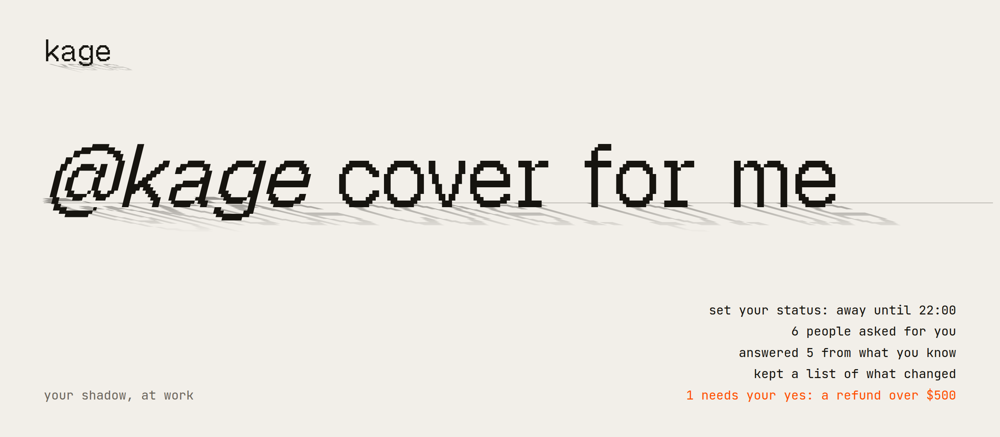

<picture>
  <source media="(prefers-color-scheme: dark)" srcset="docs/brand/hero-dark.png">
  
</picture>

Kage is your own Claude Code, reachable from Slack. Tag `@kage` in any thread and a Claude Code session on your machine does the work and answers there, with your setup and your access. You choose who else may tag it: teammates and their agents get a teammate's limits, and a voice caller or a Meet gets a guest's.

**Learn more in the [docs](https://aloki-alok.github.io/kage/docs/).**

```
#incidents  ▸ thread
  Priya      checkout is throwing 500s since the 14:05 deploy
  You        @kage what changed in that deploy?
  Kage    🥷 Looking at the deploy diff and the error logs...
  Kage       The 14:05 deploy renamed `order.total` to `order.amount`.
             3 callers still read the old name. Fix is on branch fix/order-amount.
```

## Get started

You need macOS or Linux, Node 22.18 or newer, and [Claude Code](https://code.claude.com/docs/en/quickstart) logged in.

1. Install Kage:
   ```sh
   curl -fsSL https://raw.githubusercontent.com/aloki-alok/kage/main/install.sh | bash
   ```
2. Follow the setup. It opens your Slack app with everything filled in. You click **Create** and **Allow**, then paste three tokens into the terminal.
3. Tag `@kage` in any Slack thread.

Or let a coding agent do it. Paste this into Claude Code, and it stops only for the clicks a person has to make:

```text
Set up Kage for me: run curl -fsSL https://raw.githubusercontent.com/aloki-alok/kage/main/install.sh | bash and follow what it prints.
```

If something is off, run `kage doctor`. It names the fix.

## Docs

- [How Kage works](https://aloki-alok.github.io/kage/docs/): one page per part, each with a diagram.
- [Use Kage day to day](docs/using-kage.md): commands, kagelets, teammates, security and troubleshooting.
- [Settings](docs/settings.md): every setting and its default.

## Report a bug

Open a [GitHub issue](https://github.com/aloki-alok/kage/issues). To change the code, start with [CONTRIBUTING.md](CONTRIBUTING.md).

## License

Free for personal, research, hobby and other noncommercial use, under the [PolyForm Noncommercial License 1.0.0](LICENSE). Commercial use needs a separate license: open an issue to ask.

Releases before this change stay under MIT, and so do the files listed in [LICENSE-MIT](LICENSE-MIT).
