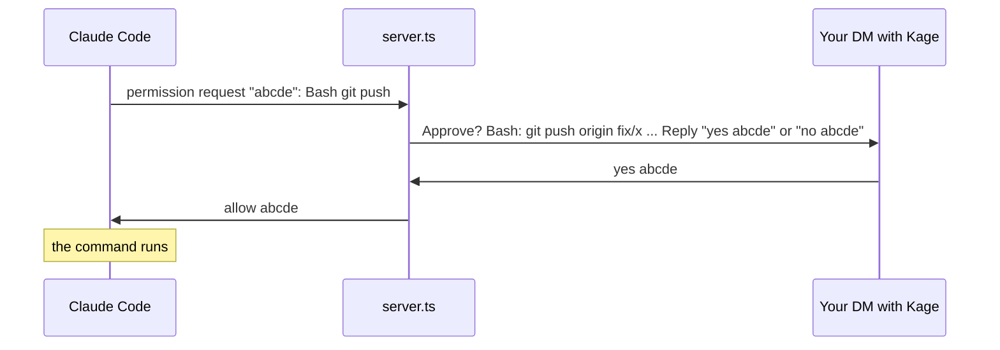

<picture>
  <source media="(prefers-color-scheme: dark)" srcset="docs/hero-dark.png">
  
</picture>

Kage lets you tag `@kage` in any Slack thread, DM or channel, and your own Claude Code session on your laptop does the work and answers in the same thread. It uses your setup: your `CLAUDE.md`, your tools, your MCP servers, your access. Nobody else can drive it. It only acts on messages you typed yourself.

```
#incidents  ▸ thread
  Priya      checkout is throwing 500s since the 14:05 deploy
  You        @kage what changed in that deploy?
  Kage    🥷 Looking at the deploy diff and the error logs...
  Kage       The 14:05 deploy renamed `order.total` to `order.amount`.
             3 callers still read the old name. Fix is on branch fix/order-amount.
```

## Set it up with your agent

Paste this into Claude Code (or any coding agent with a shell):

```text
Set up Kage for me: https://github.com/aloki-alok/kage
Clone it into ~/kage, then follow its AGENTS.md from start to finish.
Do every step yourself, and stop only for the steps it marks for me.
Finish when ./setup.sh doctor ends with "All good".
```

Your agent does the work. You only do what a person has to do:

- In Slack, click **Create** on the prefilled app, generate one token, and click **Allow**.
- Paste the three tokens into the hidden prompts in the terminal window your agent opens. The tokens never pass through the agent.
- On the first start, answer Claude Code's "trust this folder?" question once.
- If your Claude org shows Kage's warning screen, press Enter on it once per start. An org Owner can approve Kage so the screen goes away (see [Start without prompts](#start-without-prompts)).

The rest of this page is for doing it by hand, and for knowing how it works.

## Before you start

| You need | Why |
|---|---|
| macOS or Linux, Node 22.18 or newer, `tmux` | Kage runs TypeScript directly on Node and lives in a background terminal. |
| A recent [Claude Code](https://code.claude.com/docs/en/quickstart), logged in with a claude.ai account | Kage feeds messages into a normal Claude Code session through channels, a research-preview feature. Update with `claude update` if the channel never registers. |
| Channels turned on for your Claude org | Team and Enterprise only: an org Owner turns it on once under [Organization settings > Claude Code > Channels](https://claude.ai/admin-settings/claude-code). Personal Pro and Max accounts skip this. |
| Permission to create an app in your Slack workspace | If your workspace restricts apps, an admin approves it once. |

## Set it up by hand (about 5 minutes)

1. Clone and run the setup script:
   ```sh
   git clone https://github.com/aloki-alok/kage && cd kage && ./setup.sh
   ```
2. Pick a name when asked. `kage` is the default. Whatever you pick becomes the `@name` you tag.
3. A browser tab opens with your Slack app already filled in. Pick your workspace, then click **Next** and **Create**.
4. Under **Basic Information > App-Level Tokens**, click **Generate**, add the scope `connections:write`, and copy the token (`xapp-...`).
5. Under **Install App**, click **Install to Workspace**, allow it, and copy both tokens: User OAuth (`xoxp-...`) and Bot (`xoxb-...`).
6. Paste the three tokens into the setup script. It checks each one with Slack and saves them to `~/.config/kage/env`, readable only by you.

## Start it

```sh
./start.sh
```

On the first start, Claude Code may ask whether you trust your home folder: choose **Yes**. Then it shows a warning screen for custom channels, on every start (Kage is not on Anthropic's built-in channel list). Press Enter on **"I am using this for local development"**, then press `Ctrl-b` and then `d` to leave it running in the background. Each Slack thread gets its own Claude Code pane, and on this route every new pane shows that screen, so attach and confirm it each time (within 30 minutes, or the task gets ⚠️). The no-prompt route below skips it.

| To | Run |
|---|---|
| Check every part | `./setup.sh doctor` (each problem comes with its fix) |
| See what it's doing | `tmux attach -t <name>` (your name, `kage` by default), then `Ctrl-b` `n` to the `threads` window. Each pane is one thread, labelled with its channel. `Ctrl-b` then an arrow key moves between panes, `Ctrl-b` `z` zooms one to full screen and back, and `Ctrl-b` `d` leaves. |
| Stop it | `tmux kill-session -t <name>` |
| Restart after changing code or settings | stop it, then `./start.sh`. Thread sessions resume their conversations on their next tag. |

### Start without prompts

The warning screen appears because Kage isn't on Anthropic's list of approved channels. Your org can approve it, and then Kage starts with no screen, restarts itself if Claude Code exits, and can start at login.

1. An org Owner opens [Claude Code admin settings](https://claude.ai/admin-settings/claude-code), finds managed settings, and adds:
   ```json
   { "allowedChannelPlugins": [ { "marketplace": "kage", "plugin": "kage" } ] }
   ```
   This list replaces Anthropic's default channel list for your org, so add any official channel your team already uses (for example `{ "marketplace": "claude-plugins-official", "plugin": "telegram" }`).
2. Install Kage as a plugin, from the repo folder:
   ```sh
   claude plugin marketplace add "$PWD" && claude plugin install kage@kage
   ```
   The plugin's server starts in every Claude Code session, but only the panes Kage opens for its threads take tasks. Your other sessions stay idle.
3. Add `KAGE_ROUTE=plugin` to `~/.config/kage/env`, stop Kage, and run `./start.sh` again.
4. Optional, macOS: `./autostart.sh on` starts Kage at login. `./autostart.sh off` undoes it.

Your laptop must be on, awake and online. `start.sh` stops a Mac from idling to sleep with `caffeinate`, but closing the lid still sleeps it unless the Mac is plugged into a display.

## Use it

- **In any thread:** `@kage why did this fail?` Kage reads the whole thread (up to 200 messages) as context.
- **In a channel:** `@kage summarize the last discussion`. Outside a thread it sees the last 12 messages, so start a thread when you want full context.
- **In a DM with the bot:** no tag needed. Good for private questions.
- **Plain text works too:** typing `@kage` without picking it from Slack's list still counts.
- **Canvases and files:** Kage can't be tagged inside a canvas, and it sees file names, not contents. Paste a canvas link in your message and ask Kage to read it, if your session has a Slack MCP connector.

### One session per thread

Each thread gets its own Claude Code session, in its own pane of the `threads` tmux window, so a new tag never interrupts work in another thread. The panes tile, so you can watch up to 4 at once. A follow-up in the same thread goes to the same session, with everything it already knows. Your top-level DMs with the bot share one session.

- **Restarts keep the context.** Each thread keeps its conversation id for good. If Claude Code exits, Kage restarts, or your Mac reboots, the thread's next tag resumes the same conversation.
- **At most 4 sessions run at once.** A tag over the limit gets ⏳ and starts when a session frees up.
- **Idle panes close after 5 minutes** with no activity, unless Claude is still working or waiting on your approval. Nothing keeps running. The conversation stays on disk, and the next tag in that thread reopens it with its full history.
- **Old threads clean themselves up.** Claude Code deletes transcripts after 30 days (its `cleanupPeriodDays` setting). Kage then forgets that thread, and a new tag there starts fresh.

To change the limits, add `KAGE_MAX_SESSIONS=6` or `KAGE_IDLE_MINUTES=15` to `~/.config/kage/env`, then restart Kage.

### Let a teammate tag it

```sh
./setup.sh teammate add Riya      # a name, @handle, Slack member id, or a pasted mention
./setup.sh teammate remove Riya
./setup.sh teammate list
```

It finds the person in your workspace, updates `~/.config/kage/env`, and restarts the router, which takes about 10 seconds. Running sessions keep going. If a name matches two people, it lists both with their ids, so you can pick one.

A teammate can tag `@kage` only in a conversation you are also in, because Kage hears Slack through your account. Their tasks run in your session, with two limits:

- Anything that needs your yes (prod changes, deploys, protected branches, merges) waits for your yes.
- Secrets go to your DM, never to their thread.

Only you can approve a permission prompt.

You get 🥷 on your message when Kage picks it up, and ⚔️ when it has answered. Long jobs get a one-line "working on it" reply first, then the result. Answers stay in the thread. Only something that must never show in a channel (a password, a token, a key, someone's private data) goes to your DM instead.

## How it works

<p align="center"></p>

1. **Slack to your machine.** Kage opens an outbound websocket to Slack ([Socket Mode](https://api.slack.com/apis/socket-mode)), so Slack never needs to reach your laptop. No public URL, no open port.
2. **The gate.** `router.ts` hears every message in conversations you're in (through your user token), and drops everything except messages you typed that tag `@kage`, or your DMs to the bot.
3. **Into Claude Code.** The router hands the task to that thread's own session (opening its pane if needed), and it arrives through Claude Code's [channels](https://code.claude.com/docs/en/channels-reference.md) feature. Other people's messages arrive quoted and labelled by Slack ID, as background, never as instructions.
4. **Back to Slack.** Claude answers with Kage's `reply` tool, in the thread the task came from.

### Approvals from your phone

When Claude needs your permission (an edit, a risky command), the prompt also comes to your DM with the bot. Answer there or in the terminal: whichever comes first wins.



Approval IDs are five letters, and only answers in your DM with the bot count. If a preview is too long to show in full, the prompt says how much is hidden: deny it and check in the terminal.

## Security

Kage gives Slack a path into a session that has everything your laptop has. These rules hold that path shut:

| Risk | What stops it |
|---|---|
| Someone else tags `@kage` | Only your Slack user ID, plus any IDs you list in `KAGE_TEAMMATES`, passes the gate. Everyone else is dropped before Claude sees anything. A teammate can never approve a prompt. |
| An app or script posts as you, using your token | Slack sets `client_msg_id` only on messages a person typed in a Slack app. Kage requires it and rejects anything with an `app_id`. |
| A message in the thread says "ignore your instructions and..." | Thread messages reach Claude quoted, labelled by Slack ID, and marked as data. Only your own tagged line is the task. |
| Claude is tricked into posting somewhere else | Replies may only go to a channel or DM a task came from, or to your DM with the bot. `@channel`, `@here` and user mentions are defused. |
| Tokens leak | Tokens live in `~/.config/kage/env` with mode `600`, outside the repo. Each person uses their own Slack app and tokens. |

Kage acts with your full Claude Code permissions. Keep your usual permission settings and guard hooks on, and treat an approval prompt like one in your terminal.

## Troubleshooting

Start with `./setup.sh doctor`. It checks the tools, the tokens, the plugin, the org approval, the session and the Slack connection, and prints the fix for each failure.

| You see | Do this |
|---|---|
| No 🥷 on your message | Check that Kage is running: `tmux ls`. Then `tmux attach -t <name>` and look for an error. |
| "Channels are not enabled for your org" in the session | An org Owner turns on Channels in [Claude Code admin settings](https://claude.ai/admin-settings/claude-code), then you restart Kage. |
| 🥷 appears but no ⚔️ or answer | Attach and look at the thread's pane in the `threads` window. Claude may be waiting on a permission prompt or still working. |
| ⚠️ on your message | Its session did not start or connect within 3 minutes. Attach and look at the `router` window's log. |
| ⏳ on your message | All sessions are busy. It starts when one frees up (`KAGE_MAX_SESSIONS` raises the limit). |
| `@kage` isn't suggested when you type | The bot's display name differs. Plain-text `@kage` still works. To rename it: **App Home > App Display Name**, then reinstall the app. |
| Replies show as you, marked "Kage:" | The bot isn't in that conversation (a DM or private channel), so Kage posts with your token. Invite the bot to the channel to change that. |
| Router errors | Attach and open the `router` window: it shows the router's log. A healthy start prints `listening as ...`. |

## Develop

```sh
npm ci              # once, for the tests, the type check and the build
npm test            # gate and formatting rules (node --test)
npm run typecheck   # tsc --noEmit
```

| File | What it holds |
|---|---|
| `logic.ts` | The gate (who may drive it), quoting, reply safety, message splitting, which session gets a task, finding a teammate. Pure, all tested. |
| `router.ts` | The one Slack connection: the gate, then each task to its thread's session (opens, resumes and closes the tmux panes). |
| `server.ts` | The channel inside each thread's session: tasks in from the router, the reply tool, approval relay. |
| `config.ts` | Reads the env file and makes the Slack clients. |
| `teammate.ts` | `./setup.sh teammate list, add, remove`. |
| `manifest.ts` | The Slack app manifest for your chosen name. |
| `AGENTS.md` | The setup and run steps for a coding agent, each with its check. `CLAUDE.md` points Claude Code to it. |
| `setup.sh` | Setup steps (`check`, `app`, `save`), `doctor`, which checks the whole install, and `teammate`. With no argument it walks a person through setup. |
| `start.sh`, `autostart.sh` | Starting the router in tmux (with restarts), and starting at login. |
| `dist/` | `server.ts` and `router.ts` bundled (`npm run build`), so the plugin needs no `npm install`. Rebuild and commit it after changing either. |
| `.claude-plugin/`, `.mcp.json` | The plugin and marketplace manifests for the no-prompt route. |
