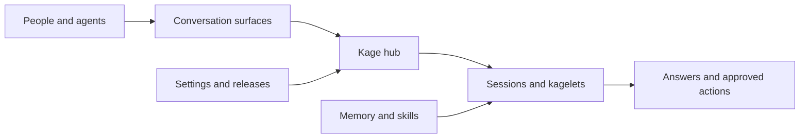

# How Kage works

[Slack threads and sessions](slack-threads-and-sessions.md) explains how conversations keep separate, resumable sessions.

[Who may drive Kage](who-may-drive-kage.md) explains how each sender reaches Kage with a different trust level.

[Approvals](approvals.md) explains how one tool call waits for one private decision.

[Kagelets](kagelets.md) explains scheduled jobs, chains, grants, and dreams.

[Memory and skills](memory-and-skills.md) explains what Kage learns locally and what every install can share.

[AFK mode](afk-mode.md) explains how Kage watches Slack while the owner is away.

[Kage in Chrome](kage-in-chrome.md) explains how Kage reads and acts in the owner's browser.

[Email](email.md) explains how authenticated mail becomes a limited Kage conversation.

[WhatsApp](whatsapp.md) explains owner tasks, armed chats, and the guarded stand-in.

[Voice and calls](voice-and-calls.md) explains caller limits and owner call verification.

[Settings and tokens](settings-and-tokens.md) explains where settings and tokens live, and why no session reads the tokens.

[Updates and releases](updates-and-releases.md) explains how tested code reaches installed hubs through `stable`.
