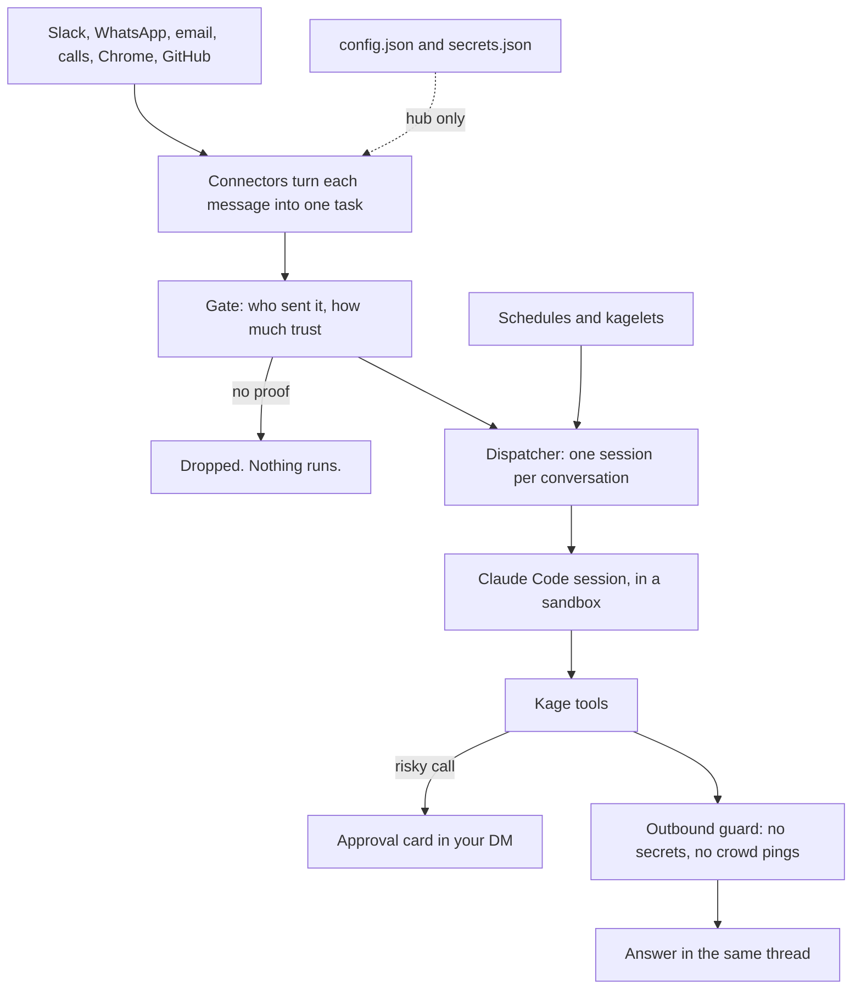

# How Kage works

Every message, from any surface, enters one process on your machine: the hub. The hub decides who sent it and how far they may go, gives each conversation its own Claude Code session, and checks everything that leaves.

## One hub, many doors

Slack, WhatsApp, email, phone calls, your Chrome and GitHub all arrive at the same place. A connector turns each one into the same task shape, so the rest of Kage never cares where a message came from.

## Trust comes from proof

The gate reads who sent a message and what proves it. Your own typed words get owner trust. A listed teammate gets teammate trust. A message with no proof is dropped before Claude ever reads it.

## One session per conversation

Each Slack thread, email thread or call keeps its own Claude Code session, and a restart resumes it.

## Risky calls wait for you

A session works with Kage's tools. A call that acts as you, such as posting somewhere new or clicking in your browser, waits for your yes on a card in your DM.

## Nothing secret leaves

Tokens live in `secrets.json`, and only the hub reads them. Every session runs in a sandbox that cannot open that file. Every outgoing message passes one guard that blocks secrets and crowd pings.

## Every page

The docs site shows the pages in this order. A new page needs its file here and one line in this list.

1. [Slack threads and sessions](slack-threads-and-sessions.md): how conversations keep separate, resumable sessions.
2. [Who may drive Kage](who-may-drive-kage.md): how each sender reaches Kage with a different trust level.
3. [Approvals](approvals.md): how one tool call waits for one private decision.
4. [Kagelets](kagelets.md): scheduled jobs, chains, grants and dreams.
5. [Memory and skills](memory-and-skills.md): what Kage learns locally and what every install shares.
6. [AFK mode](afk-mode.md): how Kage watches Slack while the owner is away.
7. [Kage in Chrome](kage-in-chrome.md): how Kage reads and acts in the owner's browser.
8. [Email](email.md): how authenticated mail becomes a limited Kage conversation.
9. [WhatsApp](whatsapp.md): owner tasks, armed chats and the guarded stand-in.
10. [Voice and calls](voice-and-calls.md): caller limits and owner call verification.
11. [Settings and tokens](settings-and-tokens.md): where settings and tokens live, and why no session reads the tokens.
12. [Updates and releases](updates-and-releases.md): how tested code reaches installed hubs through `stable`.
