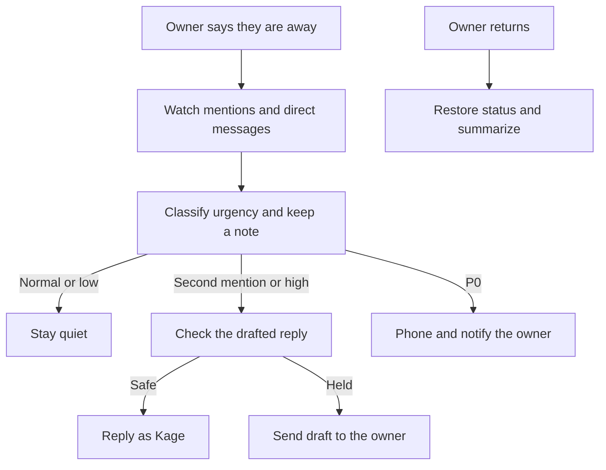

# AFK mode

AFK mode is a Slack stand-in for the owner. It watches direct messages and threads that mention them.

The stand-in stays quiet by default. A second mention or high urgency can produce a guarded reply.

A P0 can phone the owner. Calls are limited across threads, so one burst cannot keep calling.

Guests, bots, shared channels, and customer channels never receive a stand-in reply. Kage still records urgent items for the owner.

The stand-in uses read-only memory and limited GitHub reads. It cannot promise decisions, prices, deployments, or deadlines.

Every drafted reply passes a secret check and a second guard. Held drafts go to the owner instead.

When the owner returns, Kage restores the earlier status when safe. It then lists items that still need attention first.

See [the settings reference](../settings.md) for the AFK controls.
