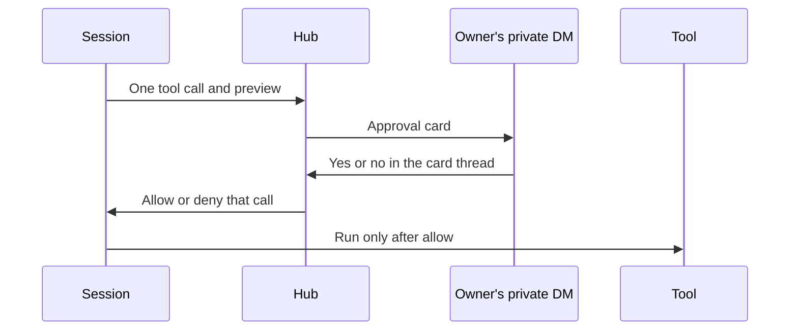

# Approvals

An approval belongs to one tool call. The card's thread connects the decision to the waiting session, so the owner types no code.

Only the owner can decide. Kage accepts the answer only inside the card's thread in the owner's bot DM.

The card shows the tool, context, and a bounded preview. A cut preview tells the owner to inspect the terminal.

An unclear answer stays on the card. A clear denial is safer than guessing permission.

The first terminal or Slack decision wins. A stopped session denies every approval that remains open.

Kagelets use a separate grant model. Their standing approvals cover named write tools, not arbitrary future calls.
