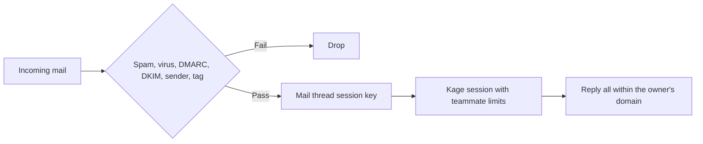

# Email

Email is another conversation surface. The first message reference becomes the stable key for its Kage session.

Kage accepts mail only from the owner address or a listed teammate address. The new text must tag Kage.

Transport checks must pass. Kage also requires the sender's mail-provider DKIM signature, because DMARC alone can accept another aligned signer.

Every email task gets teammate limits. Even mail from the owner address cannot approve tools or claim owner trust.

Earlier mail stays quoted as data. Only the new part becomes the task.

Replies keep the mail thread. Reply-all targets stay inside the owner's email domain.

See [the settings reference](../settings.md) for the email controls.
