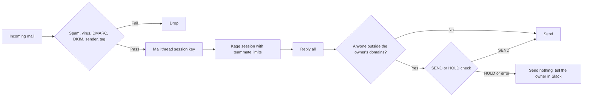

# Email

Email is another conversation surface. The first message reference becomes the stable key for its Kage session.

Kage accepts mail only from the owner address or a listed teammate address. The new text must tag Kage.

Transport checks must pass. Kage also requires the sender's mail-provider DKIM signature, because DMARC alone can accept another aligned signer.

Every email task gets teammate limits. Even mail from the owner address cannot approve tools or claim owner trust.

Earlier mail stays quoted as data. Only the new part becomes the task.

Replies keep the mail thread. Kage replies to everyone on it: the sender, To and Cc, except its own address.

If anyone is outside the owner's email domains, a check reads the reply first. It answers SEND or HOLD. On HOLD, Kage sends nothing. It tells the owner in Slack with the reason and the draft. If the check fails or times out, the reply is held too. Mail inside the owner's domains skips the check.

See [the settings reference](../settings.md) for the email controls.
