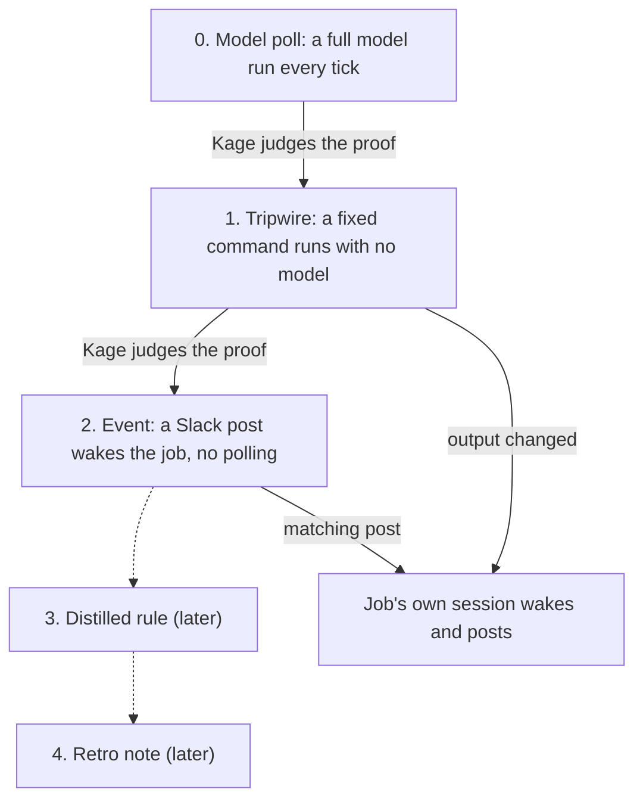

# How Kage keeps monitors cheap

A monitor that asks a model what changed pays for a full run to learn that nothing did. Kage treats that model poll as the costly first draft of a monitor. It moves the job to a cheaper step only when the cheaper step has proven it sees the same things.

## The ladder

1. **Model poll.** The job wakes a model on every tick. This works for any job, and it is the fallback when a job has nothing cheaper.
2. **Tripwire.** The job has one fixed read command. The hub runs it with no model. The model wakes only when the output changes.
3. **Event.** A Slack channel the job watches wakes it on each matching post, bots included. Nothing polls.
4. **Distilled rule, later.** The model's past decisions would become a tested rule.
5. **Retro note, later.** A job that nobody reacts to would get one line in the weekly retro.

Only steps 1 to 3 exist today. Each wake runs in the job's own lane, so its session keeps only its own earlier wakes and not the whole thread.

## Kage judges the proof

No fixed test gates a move. Before Kage moves a job to a cheaper step, it picks the proof that fits that job. It has two tools for this. It may replay the job's probe or rule over past data, and it chooses how far back. It may also run the old and the new way side by side, live, and it chooses for how long.

Kage weighs four things. How much does a missed catch cost: an alarm on live calls is not a weekly report. How often does the event happen. How much history exists. Does the asker rely on the job. A rare, costly event needs more proof than a common, harmless one.

Kage then tells the asker in one line what proof it ran and why that was enough.

## What code fixes, not Kage

Three things are fixed in code and are not Kage's call. Probe scripts are pinned (see below). A Slack channel is read again after a reconnect, so posts missed during the gap are not lost. A job is never stopped silently: Kage never stops one because it looks quiet. A quiet monitor may be working. If a probe command keeps failing, Kage sends one ping to the person who asked, with the error, and keeps trying. Stopping stays a human choice.

## Every number is a setting

The timeout, the output cap, the failure count before a ping, the model for job runs are all settings. The owner or Kage may change them while the hub runs. See the Tripwires section of [the settings reference](../settings.md).

## A probe runs only what you approved

A probe runs in the hub, outside any session's sandbox. So the rules are strict.

1. The probe command is fixed when the job is made. The approval shows it.
2. Each script the command calls is pinned by its content hash.
3. If a session edits a pinned script, the probe refuses to run. Kage asks again, and the changed script needs a new yes.

Editing a file can therefore never run new code in the hub. This is the same trust model as [Kagelets](kagelets.md) use for their database read, and it follows [Approvals](approvals.md).
