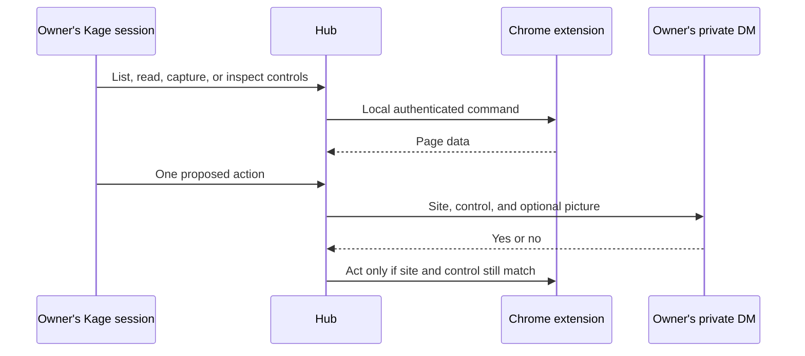

# Kage in Chrome

Kage connects to the owner's browser through a local extension. A shared token authenticates the extension to the hub.

Only the owner's own tasks can use browser tools. Teammates, agents, callers, and kagelets cannot reach them.

Kage can list tabs, read page text, capture the front tab, and inspect controls. Page words always arrive as data.

Only web pages are readable. The block list also excludes every subdomain of a blocked site.

Each click, typed value, key press, navigation, or new tab needs a private approval card.

The card names the real site and the control's current page label. A front tab can also provide a picture.

Kage checks the site and selected control again after approval. A change to either cancels the action.

See [CLAUDE.md](../../CLAUDE.md) for browser setup and [the settings reference](../settings.md) for browser policy.
