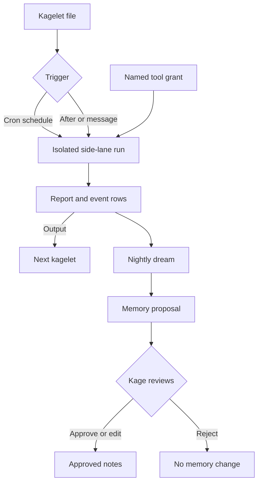

# Kagelets

A kagelet is a named job with one thread, one trigger, and a fixed tool grant.

A schedule starts a run by time. An `after` link or message starts a run from another kagelet's output.

Every run uses a side lane. The thread's main session remains separate.

Code assigns each tool to read, write, or act. Kage grants read tools without a card.

The owner's first approval can stand for one write tool. Act tools never enter a kagelet grant.

Chains cannot widen their grants. They also reject missing steps, cycles, and paths deeper than five kagelets.

Handoffs arrive as quoted data. A failed step, unmet need, refused tool, or missing report stops the chain.

A nightly dream reads one kagelet's events, reports, and approved notes. It can only propose a note change.

Kage must approve, edit, or reject every proposal. The dream never changes memory by itself.

See [the settings reference](../settings.md) for limits and cost controls.
