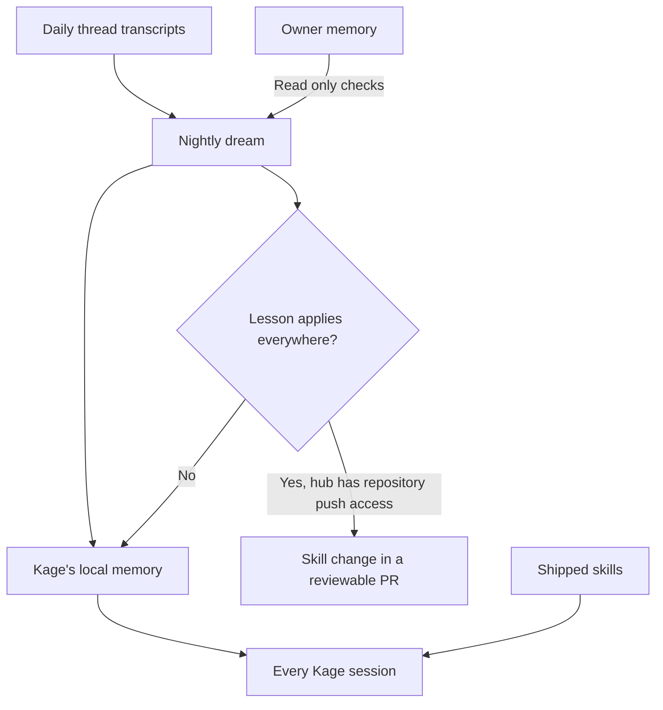

# Memory and skills

Kage keeps its own local memory. Claude Code loads that memory into Kage sessions automatically.

The nightly dream reads recent thread transcripts only while every session is quiet. It saves lasting lessons and tidies duplicates.

Kage snapshots its memory before each dream. An undo restores that snapshot and archives the replaced state.

The owner's memory is a separate source. The dream can inspect it for conflicts, but cannot change it.

Shipped skills hold lessons that apply to every owner. The repository plugin loads them into every session.

Only a hub with repository push access can propose a shared skill change. A person still must merge the proposal.

Shared lessons must exclude names, ids, dates, quotes, emails, and personal paths. Local lessons stay local.
