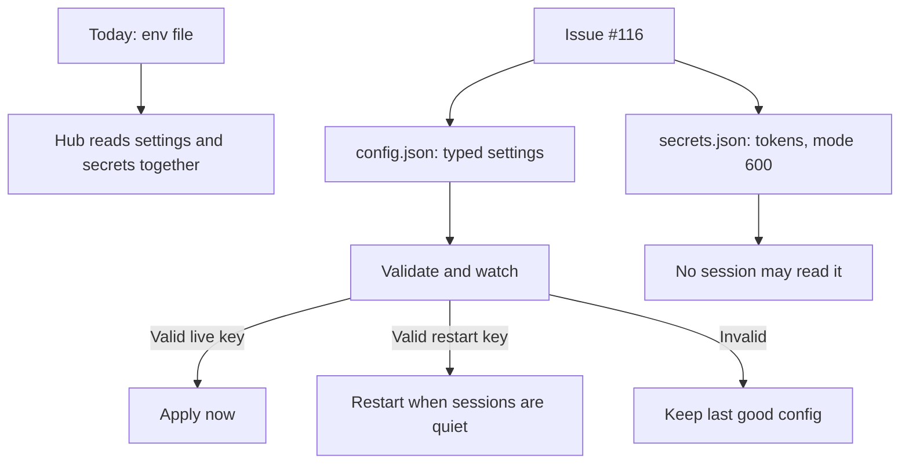

# Settings and tokens

Kage currently reads one private `env` file. That file mixes settings, allow lists, and service tokens.

Only teammate and trusted-agent lists reload live today. Other changed names wait for a restart.

Issue [#116](https://github.com/aloki-alok/kage/issues/116) implements an accepted replacement for this model.

Typed settings move to `config.json`. Tokens move to `secrets.json`, which stays private to the service.

The split lets sessions help with settings without exposing credentials. No session, including the owner's, may read `secrets.json`.

The planned watcher keeps the last valid config. People-list changes apply live, while other changes wait for quiet sessions.

Until #116 merges, the `env` file remains authoritative. [The settings reference](../settings.md) documents that current behavior.
