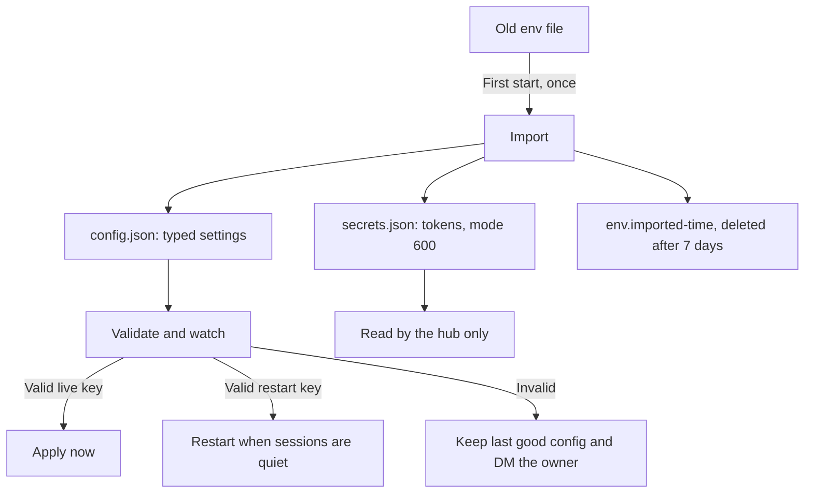

# Settings and tokens

Kage keeps settings and tokens in two files. Settings live in `config.json`. Tokens live in `secrets.json`, which is private to the owner's account.

An install from before this split had one `env` file. On its first start, the hub imports that file by itself. The old file stays as `env.imported-<time>` for 7 days.

The hub watches `config.json`. A change to `people` applies at once. Any other valid change restarts Kage once every session is quiet. An invalid file is refused, and Kage keeps the last good settings.

Sessions change settings through `kage config set` or the `set_setting` tool. A key that widens what Kage may do needs the owner's approval card first.

No session can read `secrets.json`, the owner's own sessions included. Tokens stay in the hub's memory and never enter a session's environment. A session that needs Kage to post somewhere asks the hub to do it.

[The settings reference](../settings.md) lists every key and its default.
