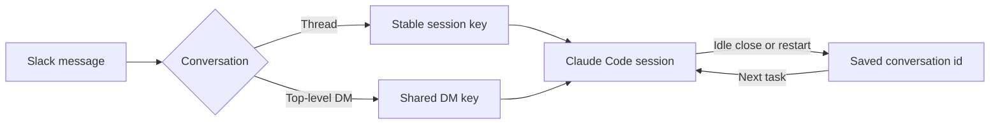

# Slack threads and sessions

A Slack thread is a conversation. Its channel and root message form a stable session key.

Top-level messages in the owner's bot DM share one rolling conversation. Replies inside explicit DM threads stay separate.

Each key maps to one Claude Code conversation. A closed runner can resume that conversation from its saved id.

The dispatcher limits concurrent sessions. Extra work waits, while a quiet session can release its slot without losing history.

Side lanes provide another session for the same conversation. They keep long work from blocking the main lane.

See [AGENTS.md](../../AGENTS.md) for commands that inspect, attach to, or stop sessions.
