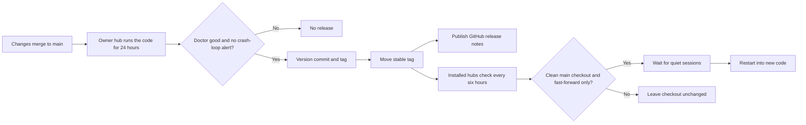

# Updates and releases

A merge to `main` does not update installed hubs. Installations follow the separate `stable` tag.

The repository admin's hub can release code that ran on it for 24 hours. A merge that changes only docs, tests, skill text or the license keeps the clock running. A code change starts it again.

The hub releases the newest commit that finished its 24 hours, even if newer code has landed since. It logs the next candidate and when its gate opens every hour. The owner can also run `kage release` to release at once.

The gate also requires a healthy doctor result and no crash loop during the run. A crash loop starts the 24 hours again. A failed gate creates no release.

A release bumps the version files and creates a version tag. It then moves `stable` and publishes the notes.

Installed hubs check `stable` every six hours. Only a clean checkout on `main` can move forward.

Updates use a fast-forward merge. A checkout with local commits or changes stays untouched.

After pulling, the hub waits until every session is quiet. It then restarts and tells the owner what changed.

Release tags are not signed yet. Issue #58 tracks that remaining trust gap.

See [AGENTS.md](../../AGENTS.md) for the supported update commands.
