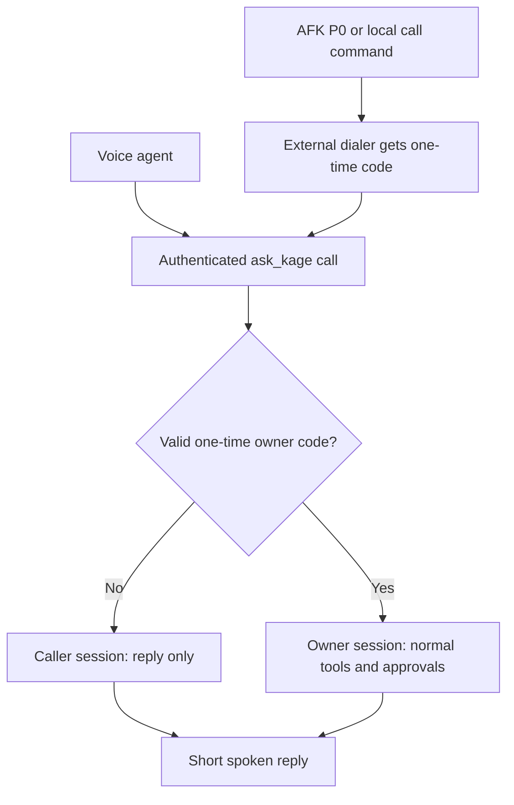

# Voice and calls

The voice connector gives a phone agent one tool named `ask_kage`. One MCP session represents one call.

Kage treats an ordinary caller as unverified. Caller ID cannot prove identity, so the session can only reply.

The restricted caller gets no shell, files, web, private sources, posts, schedules, or approval prompts.

Kage can place a call to the owner through an external dialer. The dialer receives a short-lived, one-time code.

The first call that claims that code gets owner trust until the call ends. It keeps normal tools and approval rules.

Each call keeps one conversation, so later questions retain context. Idle calls release their session and slot.

Call and hourly limits protect the owner's other sessions. A new call never evicts or jumps ahead of existing work.

See [the settings reference](../settings.md) for voice, call, and capacity controls.
