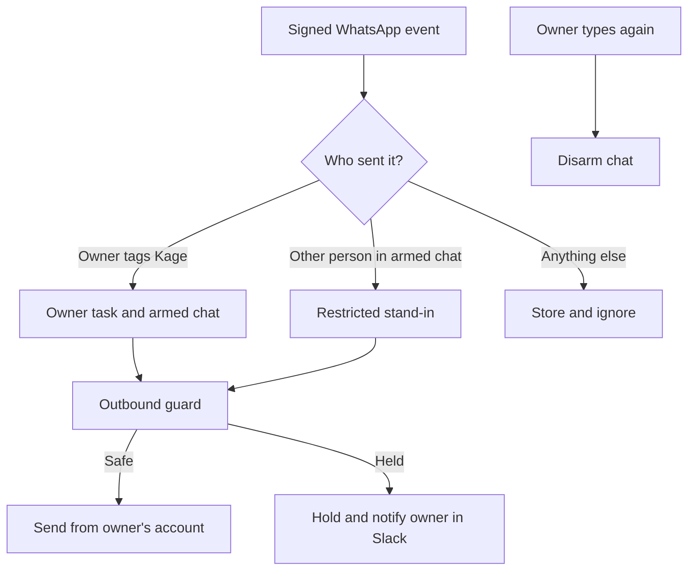

# WhatsApp

WhatsApp uses a signed webhook from WAHA, an unofficial bridge linked to the owner's account.

Only a fresh message the owner typed can start a Kage task. The message must contain Kage's tag.

That tag also arms the chat for one hour. A separate stand-in can answer later messages from that chat.

The stand-in reads only its dedicated notes and recent chat history. It has no MCP servers or project settings.

The owner's next untagged message disarms the chat. A reply limit also stops loops with automated accounts.

Every outgoing message passes a secret check and a guard. Unsafe text is held and sent to the owner's Slack DM.

WAHA is not an official WhatsApp client. Using it can put the linked account at risk.

See [the settings reference](../settings.md) for WhatsApp controls and the current risk note.
