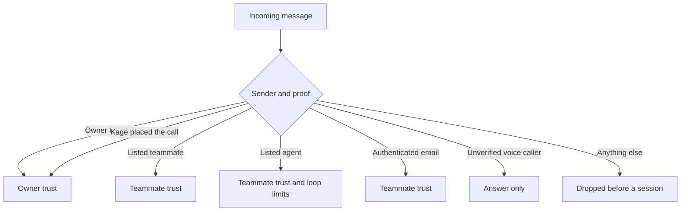

# Who may drive Kage

Kage assigns trust from evidence about the sender. A claimed name never raises that trust.

The owner gets owner trust only for words they typed. Slack proves this with person-typed message fields.

A listed teammate can start work by tagging Kage. Their task still waits for the owner when a protected action needs approval.

A listed agent counts as its listed owner, never as Kage's owner. Loop limits stop two agents from answering forever.

Email always gets teammate limits, even when it uses the owner's address. Forwarding makes the human sender uncertain.

An ordinary voice caller can only receive an answer. A call Kage placed can claim owner trust with a one-time code.

Messages without the required tag, listing, or proof drop before Claude reads them.

See [CLAUDE.md](../../CLAUDE.md) for the controls that manage teammates and agents.
