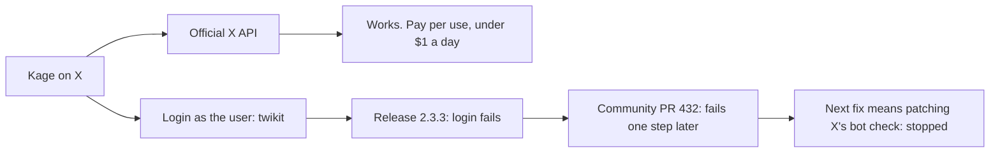

# An X connector: what was tried (Nov 2026)

The goal: tag the Kage account on X like in Slack. Only the owner's X account may start a task. Anyone else gets a short haiku written by a small model, with a link in the footer. This work is parked. Start from the official API.

## Routes compared

| Route | Reads | Posts | State on 2026-11-08 |
|---|---|---|---|
| Official X API (console.x.com) | yes | yes | Works. Pay per use, about $0.005 per post read and $0.01 per post created. X requires the "Automated" label on the account. |
| [d60/twikit](https://github.com/d60/twikit) 2.3.3 | yes | yes | Login fails: `Couldn't get KEY_BYTE indices`. |
| [vladkens/twscrape](https://github.com/vladkens/twscrape) | yes | no | Not tried. It can't post, so it can't reply. |

## What the twikit test found

1. **The code is clean.** It talks only to X, plus Capsolver if you turn that on. It has no telemetry and reads no env vars or home files. The PyPI wheel matched the GitHub source.
2. **Its JS interpreter has a known bug.** At login, twikit runs a script from X in Js2Py, which has a sandbox escape (CVE-2024-28397). Its dependency `Js2Py-3.13` is a repackaged Js2Py 0.74 with Python 3.13 fixes only. It breaks on Python 3.15 (`co_lnotab` is gone), so use Python 3.13.
3. **Release 2.3.3 can't log in.** The login needs an `x-client-transaction-id` header. X moved its site to a new build (`abs.twimg.com/x-web/...`), so twikit no longer finds the key that header needs. Upstream issues [#408](https://github.com/d60/twikit/issues/408) and [#409](https://github.com/d60/twikit/issues/409) are open, and no fix is released.
4. **PR #432 is not enough.** [PR #432](https://github.com/d60/twikit/pull/432) (July 2026) updates the old lookup. It still fails against the new build.
5. **We stopped here on purpose.** Making twikit work again means following X's anti-bot code through each site release. That is ongoing upkeep, and it breaks X's rules. It was not pursued.

## Rules for any future connector

- Check the owner by numeric X user id, not by handle. A handle can change owners.
- X replies are public. Send the full answer to the owner's Slack DM, and post only a short reply on X.
- Cap the haiku replies, for example 1 per person per day and 20 per day in total, so spam can't run up the bill.
- Copy `connectors/github.ts`: it has a rate cap, one thread per item, and runs at teammate trust.
